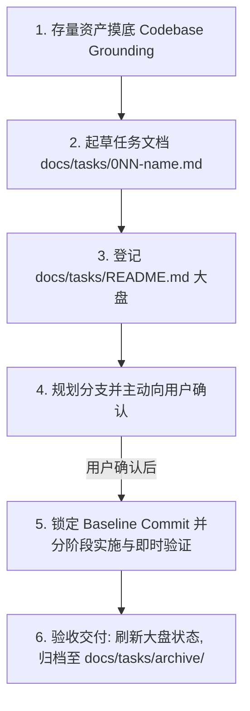

# 任务全生命周期管理与标准作业规约 (SOP)

本规约定义了 `wechat-publisher` 在任务（Task）流转过程中的标准作业步骤与红线要求。所有 AI Agent 在规划新功能、排版卡片扩展或底层重构前，必须无条件遵循。

---

## 核心红线 (The Golden Rules)

1. **红线 1：【方案先行，严禁暗箱直接改写核心代码】**
   - 面对复杂的架构升级、卡片系统扩展或流水线改动，严禁直接对生产脚本进行大改；
   - 必须先完成存量代码摸底，起草标准的任务文档并向用户汇报。
2. **红线 2：【法定三级任务命名铁律】**
   - 任务文件统一命名为 `docs/tasks/<NNN>-<task-name>.md`（如 `001-typeset-cards-pipeline.md`）；
   - **严禁带 `-plan` 后缀，严禁在文件名带 `phase-X`**；
   - 编号三位数字递增，杜绝编号跳乱或倒挂。
3. **红线 3：【分支与执行必须用户确认 (Human-in-the-Loop)】**
   - 任务方案定稿后，主动向用户汇报并询问：是在当前分支直接推进，还是新建独立特性分支；
   - 未经用户允许，严禁擅自创建或切换分支。
4. **红线 4：【临时文件严格收敛】**
   - 任务执行产生的中间临时文件必须置于 `<repo>/generated/tmp/`，严禁写入操作系统 `/tmp` 或根目录。

---

## 标准 6 步闭环作业流程 (The 6-Step Task Lifecycle)

### 步骤 1：存量资产摸底 (Codebase Grounding)
起草方案前，必须先使用搜索工具对项目中已有的脚本、主题与技术预设进行全量扫描：
- 检索 `scripts/` 与 `gen.py` 的现有入参与逻辑；
- 检索 `themes/` 与 `references/` 的现有排版样式；
- 在任务文档中如实列出摸底事实，并制定 `[ENHANCE]`、`[REFACTOR]`、`[CREATE]` 复用矩阵。

### 步骤 2：依据模板起草任务文档
- 复制 [`docs/tasks/TEMPLATE-TASK.md`](../../docs/tasks/TEMPLATE-TASK.md) 的标准章节；
- 严格遵循八大模块：背景目标、摸底事实、架构设计、实施清单、公众号生态门禁、回滚预案、验收标准、交付物闭环。

### 步骤 3：登记任务大盘
- 在 [`docs/tasks/README.md`](../../docs/tasks/README.md) 的“一、 进行中活跃任务”表格中追加新任务条目；
- 标记状态为 `待评审 (Ready for Review)` 或 `规划中 (Planning)`。

### 步骤 4：向用户发起确认 (Human-in-the-Loop)
- 向用户总结汇报任务的核心目标、涉及模块与实施方案；
- 询问分支流转策略（是在当前活跃分支实施，还是需要新建 `feature/<NNN>-<slug>` 特性分支）；
- **用户未批准前，禁止进入代码实施阶段**。

### 步骤 5：锁定基线与阶段化实施 (Fail-Fast)
1. 记录初始基线：`git log -n 1 --oneline`；
2. 按任务阶段执行编码，并遵守 AI 行为锁（`[ENHANCE]`、`[CREATE]`、`[COMPAT]`）；
3. 每完成一个阶段，立即执行即时验证命令（如 `python3 gen.py --dry-run` 或测试脚本），严禁错误累积。

### 步骤 6：验收与归档闭环 (Archive)
1. 自动化测试与排版效果全量通过；
2. 在 [`docs/tasks/README.md`](../../docs/tasks/README.md) 中将任务状态刷新为 `已完成 (Completed)`；
3. 结项后使用 `git mv` 将任务文件迁移入 [`docs/tasks/archive/`](../../docs/tasks/archive/) 目录，保持根目录清晰。
