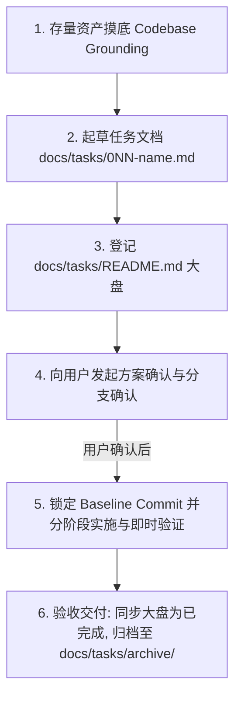

# 项目级核心规约与 Agent 指南 (Repository Rules)

> 本文件为 `wechat-publisher` 工程根级规约，对当前工作区内的所有 AI Agent 会话持续生效。
> 所有 Agent 在执行任何开发任务前必须严格遵从本规约。

---

## 1. 核心铁律与质量门禁 (Guardrails & Strict Constraints)

1. **凭据安全与防泄露铁律 (Zero Credentials Leakage)**：
   - 严禁将微信公众平台 `app_id`、`app_secret` 以及生图 API Key、百宝箱 Token 明文写入代码、任务文档或提交入库；
   - 密钥与配置统一收敛于本地私有配置文件 `wechat-publisher.yaml`（已纳入 `.gitignore`）；
   - 任何涉及配置项变更，仅允许修改脱敏的 `wechat-publisher.yaml.example` 样例文件。
2. **临时文件全封闭沙箱铁律 (Temp File Sandboxing)**：
   - 流水线生成过程中的所有临时文件（包括但不限于：Base64 解码临时图片、中间 HTML 片段、渲染截图等），**必须强制收敛在 `<repo>/generated/tmp/` 目录中**；
   - **严禁向操作系统全局目录（如 `/tmp/`、`/var/tmp/`）或项目根目录随处写入临时文件**；
   - 脚本在任务完成后应具备临时文件主动清理或生命周期管理能力。
3. **微信排版与富文本防失真铁律 (WeChat Rich Text Compliance)**：
   - 输出至微信草稿箱的正文内容必须转换为**纯行内 CSS（Inline Styles）**，严禁依赖外部外部样式表或 class 选择器；
   - 必须确保所有排版卡片和容器在 **375px 移动端视口**下表现良好，禁止发生横向滚动条或布局断裂；
   - 遵守微信公众平台排版过滤规范，严禁输出 `<script>` 标签或不可信外部链接。
4. **Git 操作与前置人机确认红线 (Human-in-the-Loop)**：
   - **严禁暗箱静默创建/切换分支**：任何分支创建与切换操作必须事先向用户说明并获得明确确认；
   - **严格区分“入库”与“推送”**：用户说“入库/提交”仅指 `git add` + `git commit`，严禁擅自执行 `git push`！仅在用户明确指示“推送/push”时方可执行；
   - **遵循 Conventional Commits 提交规范**（`feat:`, `fix:`, `docs:`, `refactor:`, `test:`, `chore:`）。

---

## 2. 三级任务法定层级与命名规范 (The 3-Tier Task Standard)

在 `docs/tasks/` 下规划任何新任务时，必须严格遵守以下三级层级与命名铁律：

```text
┌─────────────────┬─────────────────────────────────────┬────────────────────────────────────────────────┐
│ 层级            │ 物理形态 / 命名规则                 │ 核心职责与铁律                                 │
├─────────────────┼─────────────────────────────────────┼────────────────────────────────────────────────┤
│ L1 专题目录     │ docs/tasks/<NNN>-<topic-name>/      │ 业务领域专题目录（可选）；                     │
│                 │ └── README.md                       │ 内部仅包含简短业务背景 + 任务目录导航清单。    │
├─────────────────┼─────────────────────────────────────┼────────────────────────────────────────────────┤
│ L2 任务方案文件 │ docs/tasks/<NNN>-<task-name>.md     │ 独立交付任务（如 001-typeset-cards.md）；      │
│                 │                                     │ 必须以纯三位数字编号开头，1:1 对应 Task 编号； │
│                 │                                     │ 严禁带 -plan 后缀！严禁在文件名中使用 phase-X！│
├─────────────────┼─────────────────────────────────────┼────────────────────────────────────────────────┤
│ L3 任务内阶段   │ 阶段 1 / 阶段 2 / 阶段 3            │ 单任务内部的最小执行、验证与代码提交颗粒度。   │
└─────────────────┴─────────────────────────────────────┴────────────────────────────────────────────────┘
```

---

## 3. 标准化任务作业闭环 (Task Lifecycle)



### 3.1 起草前必须执行【存量资产摸底】(Codebase Grounding)
起草方案前，必须检索现有工程（`scripts/`、`gen.py`、`themes/`、`references/`），在方案第二章列出真实扫描命令与结果，坚决杜绝“假装系统没有”而重复造轮子。

### 3.2 编码操作意图显式标记 (AI 行为锁)
实施清单中每个步骤必须显式标注意图：
- **`[ENHANCE]`（增强已有）**：文件已存在，使用 `replace_file_content` 增量修改，严禁覆盖新建；
- **`[REFACTOR]`（平移重构）**：保持已有功能的前提下优化解耦；
- **`[CREATE]`（全新新建）**：系统此前不存在的新资产，必须经过摸底确认；
- **`[COMPAT]`（兼容保护）**：确保老参数与已有工作流 100% 正常运行；
- **`[CLEANUP]`（清理废弃）**：清理调试过程中产生的临时垃圾。

### 3.3 Fail-Fast 即时验证机制
每完成一个步骤，必须立即执行对应的测试或验证命令（如 `python3 gen.py --dry-run` 或 `pytest`），禁止将错误累积到最后。

### 3.4 验收与归档闭环 (Archive)
任务完成并通过验证后：
1. 更新 [`docs/tasks/README.md`](file:///home/white/github/wechat-publisher/docs/tasks/README.md) 状态为 `已完成 (Completed)`；
2. 若任务结项归档，使用 `git mv` 迁移至 `docs/tasks/archive/`。

---

## 4. 业务创作与推文生成规范 (Article Workflow Specification)

在执行任何推文内容撰写、排版生成或发布流水线开发时，必须严格遵守核心业务规约：
👉 **[`docs/ARTICLE_WORKFLOW.md`](file:///home/white/github/wechat-publisher/docs/ARTICLE_WORKFLOW.md)**

核心创作与工程红线：
1. **结构与钩子强绑定**：撰写正文前必须在 `brief.md` 明确 8 种推进结构之一与 7 种开篇 Hook 钩子之一，坚决消灭空泛的“随着……的飞速发展”式 AI 套话开篇；
2. **反 AI 6 维门禁硬约束**：推文发布前必须通过 `scripts/ai_score.py` 检测，得分 $\ge 45$ 必须强制拦截重写；
3. **双轨配图标准**：头条封面走云端生图（1 次调用），文内要点（金句、对比、清单）优先走本地无头 Chrome 排版卡渲染（0 API 消耗），临时文件严格收敛于 `generated/tmp/`。

