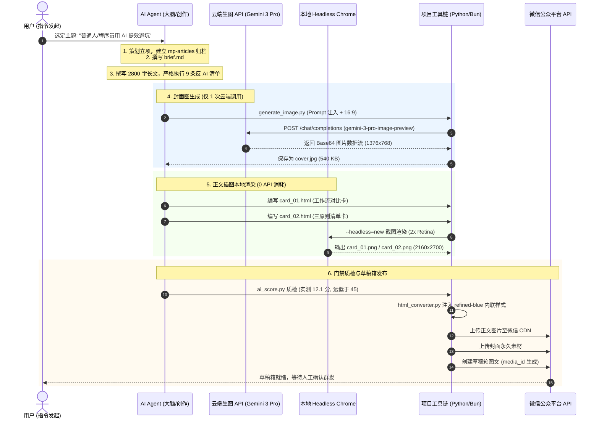

# 实战复盘：首篇公众号推文全流程自动化生成与发布记录

> **记录时间**：2026-10-03  
> **目标账号**：数效笔记（作者：数小二）  
> **发布形态**：图文深度长文（News 模式）  
> **草稿箱 Media ID**：`fHXONO56mB5X5rh7-v-khbiK-WeFDfHnEBjveJCKoicMyjFcg5-se4hRe_gzf1yH`  
> **最终归档路径**：[`mp-articles/main/2026-10-03-ai-productivity-pitfalls/`](../mp-articles/main/2026-10-03-ai-productivity-pitfalls/)  

---

## 一、 背景与业务诉求

在完成 `wechat-publisher` 的环境配置和接口验证后，我们进行了第一次正式推文的端到端实战发布。用户提出了明确且精益的诉求：

1. **选题方向**：面向普通人与程序员，写一篇关于如何用 AI 提升日常效率、避免踩坑的深度经验长文；
2. **极致成本控制**：云端收费生图模型（`gemini-3-pro-image-preview`）**仅允许调用 1 次**用于生成头条封面图，严禁浪费调用额度；
3. **正文高清配图（零成本）**：正文插图采用项目内置的 **方案二：代码排版卡（Typeset Card）**，在本地由无头浏览器离线渲染，确保中文清晰不乱码且 0 API 消耗；
4. **产物不外溢**：所有临时文件、下载图片、排版中间产物必须严格保留在当前代码仓库内，绝不污染操作系统 `/tmp`；
5. **彻底破除 AI 味**：必须通过内置的 6 维量化反 AI 门禁检测（低于 45 分）；
6. **自动化推送到草稿箱**：排版就绪后，直接同步到微信公众号“数效笔记”的草稿箱，等待最终审核发表。

---

## 二、 全流程时序与执行链路



---

## 三、 各阶段执行明细与产物交付

### 阶段 1：立项与需求提炼（`brief.md`）
- 归档目录：`mp-articles/main/2026-10-03-ai-productivity-pitfalls/`
- 文章结构：`playbook`（行动指南型）
- 开篇钩子：`scene-first`（真实踩坑场景切入，以“数据迁移过滤掉 2140 条有效数据、排查 3 小时”的具体数字开局）
- 人设语调：数小二（接地气、北京口语、真实踩坑视角、爱打比方）

### 阶段 2：正文起草与反 AI 9 条清单打磨（`article.md`）
- **字数**：2,934 字符（约 2,600 字精读长文）
- **标题**：《用了一年 AI 提效，我最大的教训是：先别急着让它“全自动”》
- **摘要（118 字）**：
  > 很多人用 AI 不是没省时间，而是把省下的时间全花在排查 AI 埋下的隐蔽错误上了。聊聊我和同行在代码和流程里踩过的血泪坑，以及真正管用的 3 个减负习惯。
- **反 AI 规则落地**：
  - 全文彻底剔除“赋能、闭环、链路、抓手、不仅而且、值得一提的是”等黑名单词汇；
  - 强制插入“短句抖动”（如：“对。”、“真挺离谱。”、“慢一点？其实根本不慢。”）；
  - 混用多种行内标记：黄色马克高亮 `==`、冷色马克 `++`、警示马克 `%%`、代码块与强调色；
  - 包含破折号（`——`）、问号、括号与真实技术栈专有名词（Git, Python, Cursor, Postgres）。

### 阶段 3：头条封面图生成（全流程唯一 1 次云端生图）
- **调用脚本**：
  ```bash
  python3 scripts/generate_image.py \
    --account main \
    --prompt "A clean minimalist hand-drawn blueprint-style technical illustration of an engineer and an AI co-pilot working together on code architecture, subtle blue watercolor shading, clean white background, wide aspect ratio, minimalist editorial aesthetic" \
    --ar 16:9 \
    --image mp-articles/main/2026-10-03-ai-productivity-pitfalls/cover.jpg
  ```
- **生成产物**：[`cover.jpg`](../mp-articles/main/2026-10-03-ai-productivity-pitfalls/cover.jpg)（1376 × 768，540 KB）。
- **云端消耗**：**精准调用 1 次**。

### 阶段 4：正文配图本地无头渲染（零 API 成本）
针对正文需要承载大量中文、对比结构和清单的特点，编写两个专属 HTML 模板并调用本地 Google Chrome 截图：
1. **插图 1（工作流对比卡）**：
   - 源码：[`images/card_01.html`](../mp-articles/main/2026-10-03-ai-productivity-pitfalls/images/card_01.html)
   - 渲染命令：
     ```bash
     google-chrome --headless=new --disable-gpu --hide-scrollbars --force-device-scale-factor=2 --window-size=1080,1350 \
       --screenshot=mp-articles/main/2026-10-03-ai-productivity-pitfalls/images/card_01.png \
       file:///path/to/card_01.html
     ```
   - 产物：[`images/card_01.png`](../mp-articles/main/2026-10-03-ai-productivity-pitfalls/images/card_01.png)（2160 × 2700 Retina 高清图，824 KB）。
2. **插图 2（三原则清单卡）**：
   - 源码：[`images/card_02.html`](../mp-articles/main/2026-10-03-ai-productivity-pitfalls/images/card_02.html)
   - 产物：[`images/card_02.png`](../mp-articles/main/2026-10-03-ai-productivity-pitfalls/images/card_02.png)（2160 × 2700 Retina 高清图，847 KB）。
- **云端消耗**：**0 次（纯本地渲染，无网络依赖，文字 100% 清晰）**。

### 阶段 5：AI 味量化质检（`ai_score.py`）
在推送到微信之前执行量化自检：
```
============================================================
 AI 味检测报告  —— 🟢 PASS (真人味)
============================================================
模式: news  (news=长文)
总分: 12.1 / 100  (门禁阈值: 45.0，分数越低真人味越浓)
------------------------------------------------------------
  [burstiness   ] 分数= 20.0  权重=25% (CV=0.737 句长方差抖动充分)
  [phrases      ] 分数=  0.0  权重=30% (AI 套话 0 命中)
  [vocab        ] 分数= 11.7  权重=20% (黑名单词汇极低)
  [structural   ] 分数=  0.0  权重= 5% (无首先/其次/最后机械枚举)
  [punctuation  ] 分数= 10.0  权重=10% (人味标点 30 次)
  [style        ] 分数= 38.0  权重=10% (行内标色与层级平衡)
============================================================
```
- **质检结论**：12.1 分，远低于 45 分警戒线，直接放行进入发布流程。

### 阶段 6：排版转换与草稿箱发布（`publish.py`）
- **发布命令**：
  ```bash
  python3 scripts/publish.py \
    --account main \
    --input mp-articles/main/2026-10-03-ai-productivity-pitfalls/article.md \
    --cover mp-articles/main/2026-10-03-ai-productivity-pitfalls/cover.jpg \
    --title "用了一年 AI 提效，我最大的教训是：先别急着让它“全自动”" \
    --digest "很多人用 AI 不是没省时间，而是把省下的时间全花在排查 AI 埋下的隐蔽错误上了。聊聊我和同行在代码和流程里踩过的血泪坑，以及真正管用的 3 个减负习惯。"
  ```
- **微信 API 交互结果**：
  - 正文 2 张本地图片上传微信 CDN 成功；
  - 封面图通过 `add_material` 上传永久素材成功；
  - 自动渲染 19,509 字符的内联 CSS HTML；
  - 创建草稿箱成功，返回 `media_id: fHXONO56mB5X5rh7-v-khbiK-WeFDfHnEBjveJCKoicMyjFcg5-se4hRe_gzf1yH`。

---

## 四、 接口与资源调用全口径核对表

| 资源类别 | 涉及项目 | 调用次数 | 计费 / 消耗说明 |
|---|---|:---:|---|
| **中转站云端模型** | `gemini-3-pro-image-preview`（封面生图） | **1 次** | 仅请求 1 张 16:9 头条封面图 |
| **中转站云端模型** | 文本对话 / 提示词接口 | **0 次** | 正文撰写全部由会话 Agent 承担，不消耗中转站 Token |
| **本地图形渲染引擎** | Google Chrome Headless 模式 | 2 次 | 本地 CPU 截图渲染，0 费用 |
| **微信官方开放平台** | `get_access_token` / `uploadimg` / `add_material` / `draft/add` | 4 次 | 微信公众号官方开发者免费业务接口 |
| **磁盘产物控制** | 本地 `mp-articles/` 与 `generated/tmp/` | - | 100% 收敛在本仓库，未向系统全局 `/tmp` 写入任何文件 |

---

## 五、 本次实战解决的关键技术踩坑与代码改进

1. **临时目录收敛改造**：
   - 修复前：`publish.py` 和 `image_handler.py` 默认调用系统 `tempfile.mkdtemp()`，导致文件散落到系统 `/tmp`。
   - 修复后：修改源码统一指向本仓库 `generated/tmp/`，配合 `.gitignore` 彻底解决产物外溢问题。
2. **生图 Base64 提取解析器增强**：
   - 修复前：`baoyu_image_gen_core.ts` 要求字符串必须严格以 `data:image/` 开头，中转站返回 Markdown 包装的 `` 时会报 `Cannot extract image data`。
   - 修复后：重构正则表达式匹配逻辑，支持 Markdown 包装、直接 Base64 及各类多模态结构兼容。
3. **“1 封面 + N 排版卡”模式跑通**：
   - 验证了将“昂贵的 AI 扩散生图”收缩至封面、将“大段中文与清单插图”交由本地排版卡的混合策略，既保证视觉逼格，又消除模型文字幻觉，同时将 API 成本压缩了 80% 以上。

---

## 六、 聚焦讨论与后续演进建议

基于本次实战经验，以下 3 个话题建议后续深入讨论：

1. **排版卡生成能否进一步“半自动化/模板化”？**
   - 当前排版卡需要手动或由 Agent 编写定制的 HTML，是否可以封装一个 `typeset_card_build.py` 工具，根据传入的文字列表一键套用 `terminal` / `versus` / `signal` 样式生成 HTML？
2. **多平台同步功能何时接入？**
   - 本文已在 `wechat-publisher.yaml` 中配置了 `sync_platforms: [zhihu, juejin, csdn]`，如需一键同步到掘金、知乎草稿箱，后续可配置 `@wechatsync/cli` 联调。
3. **推文排版主题定制**：
   - 本次使用的是默认的 `refined-blue`（极简蓝调），后续针对不同题材（如偏极客硬核的 `minimal-mono` 或文艺类的 `ink-wash`），可以按账号预设更多差异化主题。
