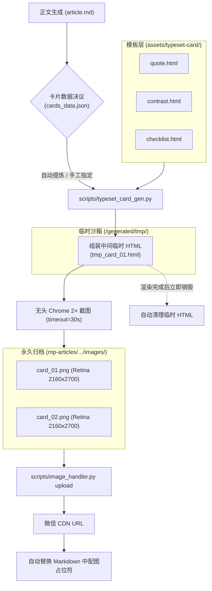

# 📌 Task 001: 排版卡片“三剑客”体系落地与流水线离线渲染引擎建设方案

> **任务编号**：`docs/tasks/001-typeset-cards-three-archetypes-and-rendering-pipeline.md`  
> **所属专题**：[`docs/tasks/README.md`](README.md)  
> **任务状态**：`待评审 (Ready for Review)`  
> **涉及端与模块**：`assets/typeset-card/` (模板层)、`scripts/` (卡片渲染器)、`gen.py` (流水线编排)、`tests/` (自动化测试)  
> **创建时间**：2026-10-03  
> **更新时间**：2026-10-03 (已完成架构审查防御加固)  
> **负责人 / Agent**：Antigravity  

---

> ### 🌟 全系统任务层级与命名法定铁律 (The 3-Tier Task Standard)
> 1. **L1 专题目录（Topic Folder - 可选）**：`docs/tasks/<NNN>-<topic-name>/`
> 2. **L2 任务方案文件（Task Plan）**：`001-typeset-cards-three-archetypes-and-rendering-pipeline.md`（严格纯三位数字前缀，严禁带 `-plan` 后缀，严禁在文件名带 `phase-X`）
> 3. **L3 任务内执行阶段（Phases）**：`阶段 1 / 阶段 2 / 阶段 3`（最小执行与验证单元）。

---

## 🏛️ 一、 任务背景、业务目标与基线锁定 (Context, Objectives & Baseline)

### 1.1 全局工程上下文与规范引用 (SSOT 指针)
- 📖 [智能体开发规范与核心规约 (`AGENTS.md`)](file:///home/white/github/wechat-publisher/AGENTS.md)
- 📖 [任务大盘与索引导航 (`docs/tasks/README.md`)](file:///home/white/github/wechat-publisher/docs/tasks/README.md)
- 📖 [排版卡片三剑客设计体系提案 (`docs/typeset-cards-design-system-proposal.md`)](file:///home/white/github/wechat-publisher/docs/typeset-cards-design-system-proposal.md)
- 📖 [排版卡设计参考 (`references/typeset-card.md`)](file:///home/white/github/wechat-publisher/references/typeset-card.md)
- 📖 [首次发布复盘与成本核算 (`docs/case-study-first-published-post.md`)](file:///home/white/github/wechat-publisher/docs/case-study-first-published-post.md)

### 1.2 本次任务微观背景与痛点 (Local Context & Pain Points)
在当前推文生成管线中，正文配图依赖 AI 生图存在两个致命痛点：
1. **中文与精确排版易糊化/幻觉**：大模型生图在文字排版、代码关键词、结构化清单上极易变形出错；
2. **手写排版卡复杂度高且易溢出**：现有 `assets/typeset-card/template.html` 仅有一个通用的终端变体，缺少类型化模板，人工修改极易在视口底部发生文字截断（Silent Clipping）；
3. **跨平台环境字体不一致**：原模板仅面向 macOS 字体（PingFang SC），在 Linux 环境下容易因字体缺失回退为丑陋的通用字体。

**本任务目标**：建立 **金句卡 (Quote Card)**、**对比卡 (Contrast Card)**、**清单卡 (Checklist Card)** 三大标准化卡片模板，通过数据与模板分离的轻量 JSON 驱动，调用本地 Chrome 2× 离线光栅化（0 API 成本），解决跨平台字体适配与防溢出问题，并将其无缝接入 `gen.py` 主编排流水线。

### 1.3 核心交付目标 (Deliverables)
1. **交付目标 1 (模板体系与字体跨端对齐)**：在 `assets/typeset-card/` 下交付 `quote.html`、`contrast.html`、`checklist.html` 三套标准卡片模板，支持 Linux/macOS 双端字体回退（`Noto Sans CJK SC`）与动态防溢出机制；
2. **交付目标 2 (安全渲染引擎)**：编写 `scripts/typeset_card_gen.py`，支持 CLI 与 Python API 接收 JSON 数据，集成 HTML 安全转义与换行转换，封装带有 `timeout=30s` 防死锁机制的 Chrome 截图命令，产出 2160×2700 高清 Retina PNG；
3. **交付目标 3 (编排与全生命周期管理)**：在 `gen.py`【步骤 3】中接入端到端卡片生成与替换闭环，明确区分中间组装临时文件（`<repo>/generated/tmp/`）与文章永久配图资产（`mp-articles/.../images/`），支持 `--dry-run` 纯净脱机演练；
4. **交付目标 4 (质量与测试套件)**：编写 `tests/test_typeset_cards.py` 自动化测试套件，覆盖三种卡片渲染、字数上限防御与数据校验，保证 100% PASS。

### 1.4 实施前 Baseline Commit ID 与分支锁定 (Baseline Locking)
- **当前仓库 (`wechat-publisher`)**：当前分支 `feature/001-typeset-cards-pipeline` | 起点 Commit ID `21914f1` (派生自 `main`)

---

## 🔍 二、 【法定门禁】存量代码资产摸底事实表 (Codebase Grounding)

### 2.1 存量资产摸底日志 (Search Evidence & Audit Log)

1. 🐍 **Python 脚本与编排器摸底 (Pipeline & CLI)**：
   ```bash
   grep -rn "typeset" gen.py scripts/
   ```
   - **扫描事实**：
     - `gen.py:8`: 注释中提及 `3. 正文插图本地渲染 (无头 Google Chrome 渲染 typeset-card HTML, 0 API 消耗)`；
     - `gen.py:208`: 目前仅为伪代码打印 `print("\n【步骤 3】本地 Chrome 渲染 2 张 typeset-card 排版卡 (0 API 费用)")`；
     - `gen.py:262-270`: 现有逻辑强依赖已存在的 `card_01.html`，缺少从数据自动生成 HTML 的前置逻辑；
     - `scripts/` 下尚无独立的 `typeset_card_gen.py` 模块。

2. 🎨 **排版卡与模板资产摸底 (Templates & Tech Presets)**：
   ```bash
   find assets/ references/ -name "*typeset*"
   ```
   - **扫描事实**：
     - `assets/typeset-card/template.html`: 通用起手式模板 (terminal 变体，1080×1350，硬编码 macOS 字体变量)；
     - `references/typeset-card.md`: 记录了 Chrome 无头截图基础参数与“静默裁切 footer”的历史踩坑记录；
     - 缺失专门的 `quote.html`、`contrast.html`、`checklist.html` 独立结构。

3. 🖥️ **本地系统字体与 Chrome 环境摸底 (System Fonts & Chrome Environment)**：
   ```bash
   which google-chrome
   fc-list :lang=zh family | sort -u
   ```
   - **扫描事实**：
     - 本机已安装 `/usr/bin/google-chrome`；
     - 中文字体拥有完整的 `Noto Sans CJK SC`（支持 Regular, Medium, Bold, Black），但无 `PingFang SC`；
     - 等宽字体拥有 `Ubuntu Mono`, `Liberation Mono`, `DejaVu Sans Mono`，但无 `SF Mono`。

### 2.2 现有资产能力与差距评估 (Capability Gap Analysis)
- **现有具备能力**：已验证无头 Chrome 2× 截图链路可行；已有 `image_handler.py` 上传至微信素材库并返回 CDN URL；已有 `gen.py` 编排框架；
- **本次缺失能力**：
  1. 缺少针对三款卡片（金句/对比/清单）的双平台高兼容预制 HTML/CSS 模板；
  2. 缺少安全转义与防死锁超时的卡片生成渲染脚本；
  3. `gen.py` 缺少卡片数据来源决议与 Markdown 相对路径占位符自动回写替换闭环。

### 2.3 资产复用与重构决策矩阵 (Reusability Matrix)

| 目标功能点 / 模块 | 现有资产路径 | 决策（`[ENHANCE]` / `[REFACTOR]` / `[CREATE]`） | 决策理由 |
| :--- | :--- | :--- | :--- |
| 卡片模板三件套 | `assets/typeset-card/template.html` | **`[CREATE]` 全新新建** | 基于 `template.html` 启发，新增三套专注结构的全新模板 `quote.html`, `contrast.html`, `checklist.html`，注入 Linux 字体回退 |
| 卡片生成渲染器 | 无 | **`[CREATE]` 全新新建** | 新建 `scripts/typeset_card_gen.py`，提供转义、渲染、超时保护与体积优化 |
| 流水线步骤 3 串联 | `gen.py` | **`[ENHANCE]` 复用增强** | 改造 `gen.py` 步骤 3，实现数据加载、卡片生成、上传与插文，并确保 `--dry-run` 纯净脱机 |
| 自动化单元测试 | `tests/` | **`[CREATE]` 全新新建** | 新建 `tests/test_typeset_cards.py`，覆盖模板渲染、防溢出与生成断言 |

---

## 🏗️ 三、 单一可信源 (SSOT) 与全局架构设计 (Architecture & SSOT)

### 3.1 数据流转与生命周期架构



### 3.2 契约规范与接口设计

#### 1. 跨平台字体栈契约 (CSS Font Stack)
所有模板统一采用高兼容双端回退字体栈：
```css
:root {
  --sans: "PingFang SC", "Noto Sans CJK SC", "Source Han Sans SC", -apple-system, sans-serif;
  --mono: "SF Mono", "Ubuntu Mono", "Liberation Mono", "DejaVu Sans Mono", ui-monospace, monospace;
  --bg1: #16171b; --bg2: #0c0d10;
  --ink: #f2f4f8; --dim: #8a90a0; --accent: #f5a623;
}
```

#### 2. 正文 Markdown 占位符契约
文章作者或生文逻辑在 `article.md` 中约定使用标准相对路径引用：
```markdown
<!-- 卡片 1 占位 (通常为金句卡) -->


<!-- 卡片 2 占位 (通常为对比卡或清单卡) -->

```
- **本地写作时**：可以直接预览本地图片；
- **发布至微信时**：`image_handler.py` 自动扫描 `images/` 相对路径，上传微信素材库并将 Markdown 中的 URL 替换为微信 CDN 链接。

#### 3. 卡片数据 JSON 契约与防溢出限制
- **金句卡 (quote)**：
  - `quote` 正文字数限制：**建议 25~45 字，硬上限 60 字**；超过 40 字时 CSS 触发 `font-size: 52px` 动态缩小（默认 `64px`）。
- **对比卡 (contrast)**：
  - `left.points` / `right.points`：每侧限制 **2~3 项**，每项文本硬上限 **35 字**。
- **清单卡 (checklist)**：
  - `items`：限制 **3~4 项**，每项标题 ≤ 12 字，说明描述 ≤ 40 字。

#### 4. 数据转义安全门禁
在 Python 生成 HTML 时，所有文本字段必须执行安全过滤：
```python
import html

safe_text = html.escape(raw_text).replace("\n", "<br/>")
```

### 3.3 深度收敛与零冗余架构 (Convergence & Zero Bloat Architecture)
为确保代码库绝对干净轻量，本方案执行三大深度收敛：
1. **职责收敛（关注点分离）**：
   `scripts/typeset_card_gen.py` 纯粹聚焦「JSON + 模板 ➔ 本地高清 PNG」，**0 网络请求、0 微信 API 依赖、0 重复逻辑**，代码量严格收敛在 120 行以内。
2. **管道收敛（零重复开发）**：
   彻底杜绝在卡片渲染器中重复编写上传代码。直接复用 `scripts/image_handler.py` 既有的 Markdown 本地图片自动提取、微信 CDN 并行上传与去重 Manifest 机制。文章只需包含 ``，发布时由原有管线自动上传并完成 URL 替换。
3. **数据来源收敛（单一可信源 SSOT）**：
   统一收敛至文章目录下的 `mp-articles/<account>/<slug>/cards_data.json`。手工撰写时可按需自定义，流水线自动化时按规则智能填充，杜绝配置项漫天散落。

---

## 📋 四、 分步实施清单 (带显式操作意图标记)

### 阶段 1：模板体系与核心渲染引擎实施
- [ ] 步骤 1.1: `[CREATE]` 在 `assets/typeset-card/` 下创建三大模板：
  - `assets/typeset-card/quote.html`（极简金句卡，半透明引号 + 弹性大字体）
  - `assets/typeset-card/contrast.html`（反差对比卡，左右双栏 + 底部结论）
  - `assets/typeset-card/checklist.html`（实操清单卡，圆点徽标 + 标题说明）
  - 🔍 即时验证: 本地 Chrome 浏览器打开验证 1080×1350 视觉排版与 `Noto Sans CJK SC` 渲染效果。
- [ ] 步骤 1.2: `[CREATE]` 编写核心渲染器 `scripts/typeset_card_gen.py`：
  - 实现 JSON 数据解析与 `html.escape` 注入；
  - 封装 Chrome headless 2× 截图命令，增加 `timeout=30` 秒守护；
  - 组装 HTML 写入 `generated/tmp/`，产物 PNG 写入指定目标路径；
  - 集成 PIL 图像体积优化（单张控制在 1MB 内）；
  - 🔍 即时验证: `python3 scripts/typeset_card_gen.py --type quote --data '{"quote":"测试金句换行\n第二行内容","accent_word":"金句"}' --output generated/tmp/test_quote.png`，校验图片分辨率为 2160×2700。

### 阶段 2：流水线编排挂载与全生命周期贯通
- [ ] 步骤 2.1: `[ENHANCE]` 改造 `gen.py` 中的【步骤 3】：
  - 检查文章目录是否存在 `cards_data.json`；若无，根据文章选题智能组装默认兜底卡片数据；
  - 调用 `typeset_card_gen.py` 生成 `card_01.png` 和 `card_02.png` 保存至 `mp-articles/<account>/<slug>/images/`；
  - 自动触发临时 HTML 文件的清理；
- [ ] 步骤 2.2: `[COMPAT]` 完善 `--dry-run` 离线演练：
  - 脱机演练模式下不探测 Chrome 二进制，直接输出预演卡片规格，100% 隔离外部依赖；
  - 🔍 即时验证: `python3 gen.py --account main --idea "测试选题" --dry-run` 端到端无报错。

### 阶段 3：自动化测试与端到端回归
- [ ] 步骤 3.1: `[CREATE]` 编写 `tests/test_typeset_cards.py`：
  - 测试三大模板的 HTML 安全注入（含双引号、换行符、HTML 标签转义）；
  - 测试实际调用 Chrome 截图生成 PNG 的尺寸（2160×2700）与非空校验；
  - 测试超时或异常参数时的友好错误抛出；
  - 🔍 即时验证: `pytest tests/test_typeset_cards.py`
- [ ] 步骤 3.2: `[CLEANUP]` 验证并确保所有生成过程中的临时文件严格收敛在 `generated/tmp/`。

---

## 🔒 五、 公众号生态与安全运行门禁 (WeChat Ecosystem & Security Gates)

### 5.1 微信凭据与敏感信息防泄露门禁
- `typeset_card_gen.py` 纯本地执行，无任何网络 API 与 Secret 依赖；
- 图片上传环节继续复用 `image_handler.py`，凭据严格由私有配置 `wechat-publisher.yaml` 托管。

### 5.2 本地临时文件与永久归档生命周期划分
- **临时沙箱隔离**：渲染过程中的组装 HTML 碎片一律写入 `<repo>/generated/tmp/`，渲染结束立即销毁；
- **永久资产留存**：最终产物 `card_01.png` 和 `card_02.png` 存储于文章归档目录 `mp-articles/<account>/<slug>/images/`，保障文章随时支持全离线复验。

### 5.3 微信富文本与排版防失真门禁
- 排版卡作为高品质 Retina 图片插入正文，彻底消除微信公众号富文本编辑器对复杂 CSS 的过滤风险；
- 原始输出统一采用 2× Retina 分辨率（2160×2700，比例 4:5），在移动端 375px~430px 屏幕下呈现如印刷品般锐利的质感。

---

## 🛡️ 六、 影响面分析、向下兼容与双向回滚预案 (Compatibility & Rollback)

### 6.1 存量系统侵入性与影响面评估 (Invasiveness: 极低 🟢)

| 现有核心模块 | 侵入程度 | 影响面分析与兼容性评估 |
| :--- | :---: | :--- |
| **`scripts/publish.py`** | **0 侵入** | **完全无需改动**。该脚本已有完整的图文处理与草稿箱推送逻辑。 |
| **`scripts/image_handler.py`** | **0 侵入** | **完全无需改动**。已有 `process_article_images` 自动处理本地相对路径上传与 CDN 替换。 |
| **`scripts/generate_image.py`** | **0 侵入** | **完全无需改动**。继续专注承担唯一的云端 AI 封面生成职责。 |
| **`scripts/ai_score.py`** | **0 侵入** | **完全无需改动**。反 AI 味 6 维质检门禁逻辑保持原样。 |
| **`gen.py`** | **微侵入** (约 25 行) | 仅替换【步骤 3】预留的未实现占位代码。新增 `--skip-cards` 显式跳过开关。所有已有 CLI 参数（`--account`, `--idea`, `--dry-run` 等）100% 保持向后兼容。 |
| **历史已发布文章** | **0 侵入** | 历史 `mp-articles/` 归档完全不受影响，旧文章可随时重新编译或发布。 |

### 6.2 坚决捍卫功能基线的四大防御装甲 (Baseline Armor)
为确保绝对不破坏现有功能基线，方案注入以下 4 重安全防御：
1. **非阻塞容错降级（Non-Blocking Failure）**：
   若无头 Chrome 遇到不可预知的渲染失败或超时，步骤 3 **仅打印 Warning 警告并平滑跳过，绝对不中断退出**，确保后续【步骤 4 反 AI 质检】与【步骤 5 微信发布】100% 正常执行。
2. **新增 `--skip-cards` CLI 显式控制**：
   在 `gen.py` 中新增 `--skip-cards` 开关（默认 False），允许用户在无 Chrome 环境或纯文字场景下一键跳过卡片生成。
3. **Pillow 依赖软导入保护 (Soft Dependency Fallback)**：
   在 `scripts/typeset_card_gen.py` 中对 PIL 执行软导入：
   ```python
   try:
       from PIL import Image
   except ImportError:
       Image = None  # 未安装时降级保存 Chrome 原始截图，绝不因缺少 PIL 而中断
   ```
   并在 `requirements.txt` 中补充 `Pillow>=9.0.0`。
4. **Linux Chrome `--no-sandbox` 容器兼容防护**：
   Chrome 无头截图命令默认追加 `--no-sandbox` 与 `--disable-dev-shm-usage`，确保在 Docker、CI/CD 或非特权 Linux 环境下稳定运行，杜绝权限崩溃。

### 6.3 双向回滚预案
- 实施出现不可逆异常时，通过 Git 一键回滚到初始基线：
  ```bash
  git reset --hard 21914f1
  ```

---

## ✅ 七、 验收标准与测试回归清单 (Acceptance Criteria & Test Suite)

- [ ] 三套模板就绪，支持 `quote`、`contrast`、`checklist`，双端字体（Linux `Noto Sans CJK SC`）渲染无错位；
- [ ] `scripts/typeset_card_gen.py` 正常运行，`timeout=30s` 生效，产出 PNG 分辨率严格为 2160×2700；
- [ ] `gen.py --account main --idea "xxx" --dry-run` 纯净脱机演练通过；
- [ ] `pytest tests/test_typeset_cards.py` 自动化测试 100% PASS。

---

## 📦 八、 交付物归档、架构文档与知识沉淀闭环 (Deliverables & Knowledge Sync)

### 8.1 交付物核对表
- [ ] `assets/typeset-card/quote.html`
- [ ] `assets/typeset-card/contrast.html`
- [ ] `assets/typeset-card/checklist.html`
- [ ] `scripts/typeset_card_gen.py`
- [ ] `gen.py`（步骤 3 增强、`--skip-cards` 开关与占位符闭环）
- [ ] `requirements.txt`（声明 `Pillow>=9.0.0`）
- [ ] `tests/test_typeset_cards.py`

### 8.2 任务大盘与索引同步
- [ ] 验收交付后，在 [`docs/tasks/README.md`](file:///home/white/github/wechat-publisher/docs/tasks/README.md) 中将 Task 001 标记为 `已完成 (Completed)`。
