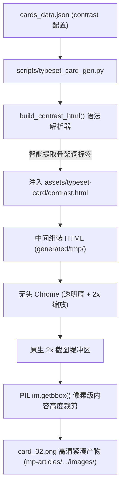

# 📌 002-contrast-card-vertical-stack-redesign 实施方案与交付计划

> **任务编号**：`docs/tasks/002-contrast-card-vertical-stack-redesign.md`  
> **所属专题**：[`docs/tasks/README.md`](README.md)（排版卡片体系演进与移动端体验优化）  
> **任务状态**：`待评审 (Ready for Review)`  
> **涉及端与模块**：`assets/typeset-card/contrast.html` (对比卡模板与样式)、`scripts/typeset_card_gen.py` (卡片渲染器与数据组装)、`tests/test_typeset_cards.py` (自动化测试套件)  
> **创建时间**：2026-10-03  
> **负责人 / Agent**：Antigravity Agent  

---

## 🏛️ 一、 任务背景、业务目标与基线锁定 (Context, Objectives & Baseline)

### 1.1 全局工程上下文与规范引用
- 📖 [智能体开发规范与核心规约 (`AGENTS.md`)](file:///home/white/github/wechat-publisher/AGENTS.md)
- 📖 [任务大盘与索引导航 (`docs/tasks/README.md`)](file:///home/white/github/wechat-publisher/docs/tasks/README.md)
- 📖 [前序任务：排版卡片三剑客管线 (`docs/tasks/001-typeset-cards-three-archetypes-and-rendering-pipeline.md`)](file:///home/white/github/wechat-publisher/docs/tasks/001-typeset-cards-three-archetypes-and-rendering-pipeline.md)

### 1.2 本次任务微观背景与痛点
- **移动端视口挤压痛点**：当前对比卡（Card 2 / Contrast）采用横向左右双栏（`left vs right`）布局。在微信移动端（375px~430px 物理屏宽）下，图片整体缩放后单栏宽度仅约 150px，15 字的长句被迫折成 3 行，文字窒息拥挤，读者的双眼必须在左右两侧反复横跳对比，认知负荷极大。
- **视觉层级均质化痛点**：原有设计左右两侧色彩均等（一红一绿），缺乏“主角光环”。读者需要的是“强烈痛点唤醒（Problem） $\rightarrow$ 破局跃迁（Shift） $\rightarrow$ 绝对主角光环的高手正解（Solution）”的单向沉浸动线。

### 1.3 核心交付目标
1. **重构对比卡 HTML/CSS 结构**：由横向左右双栏重构为**纵向上下流式堆叠（Top-to-Bottom Stacked Flow）**，单行字宽释放至 910px，支持单行平铺舒展；
2. **实现四重设计升维**：
   - 视觉非对称光影：误区卡暗哑压制（视觉权重 35%），正解卡翠绿辉光觉醒（视觉权重 65%，主角光环）；
   - 结构化关键词胶囊：每条要点支持智能提取/展示 `[ 骨架词 ]` 标签，实现 1 秒扫视建立心智映射；
   - 破局能量跃迁中轴：上下卡之间引入带有视觉动势的 `⚡ PARADIGM SHIFT // 破局跃迁 ▼` 指示桥梁；
   - 黄金法则公式胶囊：底部结论升级为醒目的琥珀金公理胶囊；
3. **引入内容流式动态高度（Dynamic Auto-Height）**：与金句卡一致，采用 `height: auto` 与 Chrome 透明画布光栅化 + PIL `getbbox()` 像素级裁剪，彻底消灭上下冗余黑底空白；
4. **100% 向后兼容历史数据契约**：兼容纯文本字符串列表与结构化数据，确保全量测试通过。

### 1.4 实施前 Baseline Commit ID 与分支锁定
- **当前仓库**：`wechat-publisher`
- **当前分支**：`feature/001-typeset-cards-pipeline`
- **Baseline Commit**：`937ee80` (`fix(converter): deduplicate section dividers and avoid collisions before h2 headings`)

---

## 🔍 二、 【法定门禁】存量代码资产摸底事实表 (Codebase Grounding)

### 2.1 存量资产摸底日志

1. 🐍 **Python 脚本与流水线扫描**：
   ```bash
   grep -rn "contrast" scripts/ gen.py
   ```
   **扫描结果**：
   - `scripts/typeset_card_gen.py:35`: `SUPPORTED_TYPES = ("quote", "contrast", "checklist")`
   - `scripts/typeset_card_gen.py:113`: `def build_contrast_html(template: str, data: Dict[str, Any]) -> str:`
   - `scripts/typeset_card_gen.py:253`: `elif card_type == "contrast": rendered_html = build_contrast_html(...)`
   - `scripts/typeset_card_gen.py:277`: 现有固定窗口高度注释，需纳入自适应高度改造
   - `gen.py:298`: dry-run 对比卡尺寸说明
   - `gen.py:367`: 默认卡片配置中包含 `type: contrast` 数据结构

2. 🎨 **排版主题与模板扫描**：
   ```bash
   find assets/ -name "*contrast*"
   ```
   **扫描结果**：
   - `assets/typeset-card/contrast.html`: 现有左右双栏模板（231 行），需重构为纵向流式自适应模板。

3. 🧪 **测试套件扫描**：
   ```bash
   grep -rn "contrast" tests/
   ```
   **扫描结果**：
   - `tests/test_typeset_cards.py:152`: `test_render_contrast_card` 验证对比卡渲染
   - `tests/test_typeset_cards.py:267`: 批量渲染测试中使用 contrast 卡片契约

### 2.2 现有资产能力与差距评估

| 维度 | 现有资产能力 (`contrast.html` / `typeset_card_gen.py`) | 本次重构需求差距 (Gap) |
| :--- | :--- | :--- |
| **布局方向** | 横向双栏 `display: flex; flex-direction: row;` | 需重构为纵向堆叠 `flex-direction: column;` |
| **容器高度** | 写死 `height: 1350px; overflow: hidden;` | 需重构为自适应 `height: auto; background: transparent;` |
| **视觉层级** | 左右卡片视觉权重对等（红绿平分） | 需重构为不对称光影：误区暗哑收敛，正解高光主角 |
| **要点结构** | 仅纯文本 `point-bullet` + `point-text` | 需支持关键词胶囊 `[ 骨架词 ]`，实现 3 秒眼动定焦 |
| **转折指示** | 无中间转折过渡，左右卡之间只有 32px 间隙 | 需新增高科技破局跃迁轴（The Shift Node） |
| **裁剪算法** | 固定裁剪前 2700 高度，易留白边 | 需复用 PIL `im.getbbox()` 内容驱动动态高度裁剪 |

### 2.3 资产复用与重构决策矩阵

| 目标资产路径 | 决策类型 | 决策理由与改造重点 |
| :--- | :--- | :--- |
| `assets/typeset-card/contrast.html` | **`[REFACTOR]` 平移重构** | 保持已有占位符契约不变，将 CSS 布局全面升级为上下堆叠流动与非对称高光 |
| `scripts/typeset_card_gen.py` | **`[ENHANCE]` 复用增强** | 在 `build_contrast_html` 中增加骨架词胶囊解析能力；将 `contrast` 纳入 `im.getbbox()` 自适应高度光栅化 |
| `tests/test_typeset_cards.py` | **`[ENHANCE]` 增量加固** | 更新尺寸断言为自适应高度校验；补充上下堆叠 DOM 节点与关键词标签测试用例 |

---

## 🏗️ 三、 单一可信源 (SSOT) 与全局架构设计 (Architecture & SSOT)

### 3.1 本次任务在发布流水线中的定位
- [x] **C. 排版卡片与视觉生成 (Typeset Cards & Visuals)**
- [x] **F. 主编排器与 CLI 工具链 (Pipeline Orchestration & CLI)**

### 3.2 物理目录落点与单一导出收敛
- **修改文件**：
  1. [`assets/typeset-card/contrast.html`](file:///home/white/github/wechat-publisher/assets/typeset-card/contrast.html)
  2. [`scripts/typeset_card_gen.py`](file:///home/white/github/wechat-publisher/scripts/typeset_card_gen.py)
  3. [`tests/test_typeset_cards.py`](file:///home/white/github/wechat-publisher/tests/test_typeset_cards.py)
  4. [`gen.py`](file:///home/white/github/wechat-publisher/gen.py)（更新 dry-run 卡片描述）
- **单一导出入口**：`scripts/typeset_card_gen.py::render_card("contrast", data, out_path)`

### 3.3 数据流转架构图



### 3.4 数据契约设计 (向后兼容保障)

`cards_data.json` 中要点支持以下三种格式，系统自适应解析：
1. **带方括号标签**：`"[ 逻辑脱节 ] 素材生搬硬套模板，声画与文案完全脱节"` $\rightarrow$ 自动分离出属性标签胶囊与说明正文；
2. **带冒号标签**：`"逻辑脱节：素材生搬硬套模板..."` $\rightarrow$ 自动识别冒号前为属性标签；
3. **传统纯文本**：`"素材生搬硬套模板，声画与文案完全脱节"` $\rightarrow$ 优雅降级为单行纯正文显示。

---

## 📋 四、 分步实施清单 (带显式操作意图标记)

### 阶段 1：HTML 模板与非对称光影重构
- [ ] 步骤 1.1: `[REFACTOR]` 重构 [`assets/typeset-card/contrast.html`](file:///home/white/github/wechat-publisher/assets/typeset-card/contrast.html)
  - 移除固定 `1350px` 高度与绝对定位，改为 `width: 1080px; height: auto;` 流式文档；
  - 容器重构为纵向堆叠 `.stack`，各卡内间距舒适展开；
  - 实现误区卡（暗红、低饱和、冷灰字）与正解卡（翠绿、高亮、柔光扩散）视觉层级不对称；
  - 插入居中破局跃迁轴（`⚡ PARADIGM SHIFT // 破局跃迁 ▼`）；
  - 底部重构为琥珀金法则公式胶囊；
  - 🔍 即时验证：检查模板内占位符完整性（`{{KICKER}}`, `{{TITLE}}`, `{{LEFT_CONTENT}}`, `{{RIGHT_CONTENT}}`, `{{CONCLUSION}}`）。

### 阶段 2：渲染脚本自适应高度与骨架词解析增强
- [ ] 步骤 2.1: `[ENHANCE]` 升级 [`scripts/typeset_card_gen.py`](file:///home/white/github/wechat-publisher/scripts/typeset_card_gen.py) 的 `build_contrast_html()`
  - 编写防守式要点解析逻辑，支持智能提取 `[ 标签 ]` 并包装为 `<span class="point-badge">`；
- [ ] 步骤 2.2: `[ENHANCE]` 扩展 `render_card()` 动态高度自适应
  - 将 `is_dynamic_height = card_type in ("quote", "contrast")`；
  - Chrome 统一传入大视口（`1080,2600`）配合 `--default-background-color=00000000`；
  - PIL 阶段通过 `im.getbbox()` 自动贴合裁剪，生成紧凑无黑底留白的最终 PNG；
  - 🔍 即时验证：单卡渲染命令执行并校验输出尺寸与透明裁剪结果。

### 阶段 3：自动化测试更新与全链路端到端回归
- [ ] 步骤 3.1: `[ENHANCE]` 更新 [`tests/test_typeset_cards.py`](file:///home/white/github/wechat-publisher/tests/test_typeset_cards.py)
  - 将对比卡尺寸断言从固定 2700 升级为自适应区间校验（`assert im.size[0] == 2160 and 1200 <= im.size[1] <= 3000`）；
  - 补充骨架词标签渲染与上下堆叠结构校验用例；
  - 🔍 即时验证：`pytest tests/test_typeset_cards.py -v`（19/19 PASSED）；
- [ ] 步骤 3.2: `[ENHANCE]` 重新渲染当前推文卡片资产
  - 重新渲染 `mp-articles/main/2026-10-03-post-211754/images/card_02.png`；
  - 校验图片尺寸与视觉质量。

---

## 🔒 五、 公众号生态与安全运行门禁 (WeChat Ecosystem & Security Gates)

### 5.1 微信凭据与敏感信息防泄露门禁
- 保持 0 凭据接触，纯本地光栅化渲染，不触碰 API Keys。

### 5.2 本地临时文件全封闭生命周期
- 渲染中间产生的组装 HTML 必须且仅写入 `generated/tmp/` 沙箱，并在 `finally` 块中立即安全删除。

### 5.3 移动端视口与富文本防失真
- 卡片内部所有样式全部内联化或收敛在模板 `<style>` 中，截图转换为高清 Retina PNG（宽度 2160，逻辑 1080），手机端以 100% 宽度自适应展示，横向无溢出。

---

## 🛡️ 六、 影响面分析、向下兼容与双向回滚预案 (Compatibility & Rollback)

### 6.1 影响面与向下兼容评估
- **纯展现层优化**：不修改微信发布接口、不修改 Markdown 语法协议；
- **老数据 100% 兼容**：现有纯文本格式的 `cards_data.json` 无需修改任何字段即可正常运行；
- **流水线无缝衔接**：`gen.py` 生成的 `cards_data.json` 自动适配新布局。

### 6.2 双向回滚预案
- 若出现非预期布局崩塌，一键快速回滚至基线：
  ```bash
  git checkout 937ee80 -- assets/typeset-card/contrast.html scripts/typeset_card_gen.py tests/test_typeset_cards.py
  ```

---

## ✅ 七、 验收标准与测试回归清单 (Acceptance Criteria & Test Suite)

- [ ] 单元测试全部通过：`pytest tests/test_typeset_cards.py -v`；
- [ ] 全量测试无破坏：`pytest tests/test_html_converter.py -v`；
- [ ] 产物图像验证：`card_02.png` 呈现上下堆叠布局，误区暗哑、正解发光，内容紧凑无多余空白；
- [ ] 移动端真机可读性：单条要点文字一行舒展，不再出现密集多行折行。

---

## 📦 八、 交付物归档与状态同步 (Deliverables & Status Sync)

- [ ] 核心模板与脚本修改入库（Conventional Commit 规范，仅本地 commit，未经允许不 push）；
- [ ] 任务大盘 [`docs/tasks/README.md`](README.md) 状态同步更新；
- [ ] 本地重新生成 `post-211754` 最新配图并提供一键发布命令。
