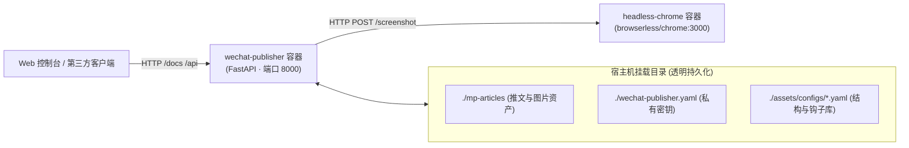

# 📌 003-docker-api-service-and-architecture 实施方案与交付计划

> **任务编号**：`docs/tasks/003-docker-api-service-and-architecture.md`  
> **所属专题**：[`docs/tasks/README.md`](README.md)（已登记任务大盘）  
> **任务状态**：`暂不实现 (Deferred / Backlog)`  
> **涉及端与模块**：`FastAPI (新服务)` / `Docker Compose (双容器组)` / `assets/configs/ (YAML配置库)` / `scripts/` / `gen.py`  
> **创建时间**：2026-10-04  
> **当前结论**：完成技术架构设计与 API 接口契约规划，方案已归档锁定，暂不进入编码实施阶段。  

---

## 🏛️ 一、 任务背景、业务目标与基线锁定 (Context & Baseline)

### 1.1 全局工程上下文与规范引用
- 📖 [推文创作与发布工作流规约 (`docs/ARTICLE_WORKFLOW.md`)](file:///home/white/github/wechat-publisher/docs/ARTICLE_WORKFLOW.md)
- 📖 [智能体开发规范与核心规约 (`AGENTS.md`)](file:///home/white/github/wechat-publisher/AGENTS.md)
- 📖 [任务大盘与索引导航 (`docs/tasks/README.md`)](file:///home/white/github/wechat-publisher/docs/tasks/README.md)
- 📖 [文章结构与开篇钩子库 (`references/article-structures.md`)](file:///home/white/github/wechat-publisher/references/article-structures.md)

### 1.2 本次任务背景与演进诉求
当前 `wechat-publisher` 是一套完善的本地 Python CLI 工具链。为了支持未来接入 Web 控制台、前端仪表盘、飞书/企微机器人或第三方系统，需要将核心能力升级为 **面向微服务架构的 RESTful API 引擎**。

在架构设计上明确两大核心诉求：
1. **宿主机零污染**：采用 Docker 容器化隔离，且不在宿主机安装 Chrome 与复杂的图形库；
2. **能力 API 化**：将推文生命周期（简易生成/完整生成/预览）、封面图生成、以及核心创作心法（文章结构与 Hook 钩子）通过标准 API 暴露。

### 1.3 核心技术决策（经人机会话确认）
1. **容器组架构选型**：采用 **双容器解耦架构 (Docker Compose)**
   - 容器 1：`wechat-publisher` 业务容器（轻量 Python 3.12 + FastAPI，暴露 8000 端口，挂载 `./mp-articles` 与配置）；
   - 容器 2：`headless-chrome` 渲染容器（官方高可用镜像 `browserless/chrome`，专职处理卡片 2x 高清截屏，内存故障隔离）。
2. **知识库持久化格式**：**严格采用 YAML 文件存储**
   - 推进结构数据：`assets/configs/article_structures.yaml`
   - 开篇钩子数据：`assets/configs/opening_hooks.yaml`
   - 优势：人机可读性强、天然享受 Git 版本追溯、免去引入重型数据库的运维成本。
3. **实施节奏**：**当前标记为“暂不实现”**，方案作为架构资产归档备案，待业务排期确认后再行启动。

### 1.4 基线 Commit ID 锁定
- **当前仓库 (`wechat-publisher`)**：分支 `feature/001-typeset-cards-pipeline` | Baseline Commit ID `a878160`

---

## 🔍 二、 存量资产摸底事实表 (Codebase Grounding)

### 2.1 存量代码与模块现状
```bash
# 检索现有脚本核心能力
ls -l scripts/
# 结果包含:
#   publish.py (微信草稿箱发布)
#   html_converter.py (Markdown -> 微信内联 CSS)
#   typeset_card_gen.py (卡片离线截图生成)
#   ai_score.py (反 AI 味 6 维检测)
#   generate_image.py (封面图生成)
```
- **现有能力**：业务逻辑均已在 `scripts/` 中完成模块化，且拥有单测覆盖；
- **差距分析**：缺乏 HTTP Web 框架包装层、缺乏远程 Chrome HTTP 截图适配器、结构与钩子硬编码在 Markdown 中缺乏动态加载器。

---

## 🏗️ 三、 架构设计与 API 路由契约 (Architecture & API Specs)

### 3.1 容器拓扑与网络拓扑



### 3.2 核心 API 分类路由契约

#### 分类 1：推文核心 API (`/api/v1/articles`)
- **`POST /api/v1/articles/generate/simple`（简易生成 · 快速出稿）**
  - 入参：`{ "idea": "string", "structure": "playbook", "hook": "scene-first", "account": "main" }`
  - 逻辑：仅调度 LLM 撰写 Markdown 骨架并执行阶段 3.5 人味化改写，不调用生图与 Chrome 截屏；
  - 响应：`{ "title": "...", "digest": "...", "markdown": "...", "post_dir": "..." }`（耗时约 3~5 秒）。
- **`POST /api/v1/articles/generate/full`（完整生成 · 端到端流水线）**
  - 入参：`{ "idea": "string", "theme": "refined-blue", "publish_to_wechat": false }`
  - 逻辑：完整执行选题规划 $\rightarrow$ 封面生图 $\rightarrow$ 排版卡渲染 $\rightarrow$ 反 AI 检测 $\rightarrow$ 可选推送到草稿箱；
  - 响应：`{ "task_id": "...", "status": "completed", "article_url": "...", "ai_score": 28.5, "media_id": "..." }`。
- **`POST /api/v1/articles/preview`（实时排版预览）**
  - 入参：`{ "markdown": "string", "theme": "refined-blue" }`
  - 逻辑：调用 `html_converter.py` 将 Markdown 编译为纯行内 CSS HTML；
  - 响应：`{ "html": "<section style=...>" }`（毫秒级返回，可直接嵌入 iframe 预览）。

#### 分类 2：封面与视觉 API (`/api/v1/covers`)
- **`POST /api/v1/covers/from-article`（按文章自动提炼生图）**
  - 入参：`{ "article_dir": "2026-10-03-xxx", "style": "hand-drawn-blue" }`
  - 逻辑：自动读取该文章的标题与正文摘要，组合出专属 Prompt，调用云端模型生成 16:9 封面；
  - 响应：`{ "cover_path": "mp-articles/.../cover.jpg", "cover_url": "..." }`。
- **`POST /api/v1/covers/custom`（自定义提示词生图）**
  - 入参：`{ "prompt": "...", "ar": "16:9", "style": "infographic-warm" }`
  - 响应：`{ "image_url": "..." }`。

#### 分类 3：创作心法配置 CRUD API (`/api/v1/configs`)
数据持久化在 `assets/configs/article_structures.yaml` 和 `assets/configs/opening_hooks.yaml`：

| 接口地址 | 方法 | 功能描述 |
| :--- | :--- | :--- |
| **`/api/v1/configs/structures`** | `GET` | 查询所有已注册的推进结构清单（含适合题材、推进步骤） |
| **`/api/v1/configs/structures`** | `POST` | 新增一种自定义推进结构（写入 YAML） |
| **`/api/v1/configs/structures/{key}`** | `PUT` | 修改特定结构的推进规则或适用说明 |
| **`/api/v1/configs/structures/{key}`** | `DELETE` | 删除或下线特定推进结构 |
| **`/api/v1/configs/hooks`** | `GET` | 查询所有已注册的开篇 Hook 钩子清单 |
| **`/api/v1/configs/hooks`** | `POST` | 新增一种自定义开篇 Hook（写入 YAML） |
| **`/api/v1/configs/hooks/{key}`** | `PUT` | 修改特定 Hook 钩子的写作指引与避坑项 |
| **`/api/v1/configs/hooks/{key}`** | `DELETE` | 删除特定开篇 Hook |

---

## 🛠️ 四、 未来实施路线图（待启动时执行）

当后续决定启动实施时，按以下 4 个阶段有序落地：

- **阶段 1：配置抽取与 YAML CRUD 模块实现**
  - 将 `references/article-structures.md` 中的 8 种结构与 7 种钩子结构化迁移到 `assets/configs/*.yaml`；
  - 编写 `scripts/config_manager.py` 提供 YAML 安全读写与校验。
- **阶段 2：Docker Compose 双容器环境编排**
  - 编写 `docker-compose.yml` 引入 `browserless/chrome` 与 Python 业务容器；
  - 改造 `scripts/typeset_card_gen.py`，支持读取环境变量 `SCREENSHOT_SERVICE_URL`，平滑支持本地 Chrome 与远程 HTTP 截图双模式。
- **阶段 3：FastAPI 接口层实现与挂载**
  - 编写 `api/` 路由模块，暴露上述 3 大类 API；
  - 集成 Pydantic 数据模型与错误处理。
- **阶段 4：自动化集成测试与 Swagger 验收**
  - 编写 `tests/test_api.py` 覆盖 3 大类接口；
  - 验证 Swagger UI 交互式控制台正常工作。

---

## 🏁 五、 结论与状态标识

本方案已完整吸纳会话讨论的所有共识（双容器组隔离、YAML 持久化、3 类功能划分）。  
**当前状态：`暂不实现 (Deferred / Backlog)`**，方案已入库固化，未来随时可一键唤醒并进入执行。
