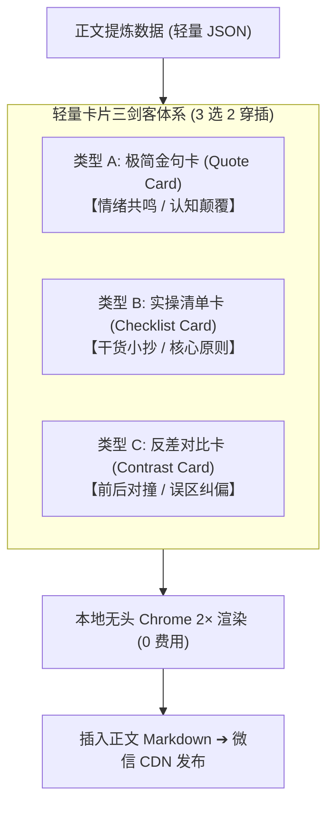

# 正文轻量卡片体系规范方案：Typeset Card「三剑客」设计系统

> **文档状态**：讨论评审稿（Proposal）  
> **制定时间**：2026-10-03  
> **适用范围**：`wechat-publisher` 正文配图标准化与自动化生成管线  
> **核心目标**：彻底降低正文配图的维护复杂度，以“数据与样式分离”的 3 款标准化模板取代手写 HTML，实现 0 API 成本、极简自动化提取、高质感微信阅读体验。

---

## 一、 方案背景与核心痛点

在之前的推文流水线演进中，我们确立了**“1 张云端封面 + N 张本地排版卡”**的极致性价比策略。但在实际执行中发现：

1. **手写排版卡复杂度过高**：原版 HTML/CSS 结构包含多种布局（表格、带边框的复杂卡片等），很难由脚本全自动提取生成；
2. **文字溢出风险**：由于每篇文章字数不一，定制化排版极易出现内容过长被视口悄悄裁切（Silent Clipping）的严重问题；
3. **单一金句卡过于单调**：如果通篇只用同一种大字金句卡，全篇阅读缺乏节奏变化。

**本方案的解法**：  
建立**「轻量卡片三剑客（Typeset Cards Design System）」**标准设计系统。固定 3 种版式，数据以极简 JSON 输入，正文完成后**“3 选 2”**自动生成并穿插。

---

## 二、 「轻量卡片三剑客」标准化规格规范

三款卡片均基于统一的 **1080 × 1350** 画布比例，由本地无头 Google Chrome 以 **2× 设备像素比** 离线光栅化为 **2160 × 2700** 的超高清 Retina PNG，确保文字如印刷品般锐利。



---

### 1. 【类型 A：极简金句卡（Quote Card）】

#### (1) 定位与适用场景
- **核心定位**：全篇的“灵魂一句话”，负责认知颠覆、情绪共鸣，激发读者截图发朋友圈。
- **最佳位置**：文章开篇引言后，或第一核心观点总结处。
- **字数规范**：20 ~ 35 字，大留白、超大字体、大行距。

#### (2) UI 布局与文字示意图
```text
┌──────────────────────────────────────────────────────────────┐
│  QUOTE // 核心洞察                                           │  ← [Kicker 顶部小标]
│                                                              │
│    “                                                         │  ← [半透明大双引号装饰]
│                                                              │
│    AI 最危险的时刻，                                         │  ← [64~72px 超大字金句]
│    从来不是它告诉你“我不会”，                                │
│    而是它一本正经地输出一份                                  │
│    看似完美、实则暗藏隐形炸弹的代码。                        │  ← [核心词上品牌强调色]
│                                                              │
│                                                              │
│    —— 数效笔记 · 数小二 // 踩坑实录                          │  ← [底部极简署名]
└──────────────────────────────────────────────────────────────┘
```

#### (3) 数据契约（输入 JSON 结构）
```json
{
  "type": "quote",
  "kicker": "QUOTE // 核心洞察",
  "quote": "AI 最危险的时刻，从来不是它告诉你“我不会”，而是它一本正经地输出一份看似完美、实则暗藏隐形炸弹的代码。",
  "highlight_phrase": "暗藏隐形炸弹的代码",
  "author": "数效笔记 · 数小二 // 踩坑实录"
}
```

---

### 2. 【类型 B：实操清单卡（Checklist Card）】

#### (1) 定位与适用场景
- **核心定位**：可直接照着抄作业的“实操小抄”，负责输出干货价值，引导读者收藏。
- **最佳位置**：文章方法论小节之后，或正文后半段解决方案处。
- **要点规范**：严格固定为 **3 条**，每条标题 $\le 12$ 字，描述 $\le 45$ 字。

#### (2) UI 布局与文字示意图
```text
┌──────────────────────────────────────────────────────────────┐
│  PRACTICAL CHECKLIST // 实操避坑指南                         │  ← [Kicker 模块微型标]
│                                                              │
│  日常高效用 AI 的                                            │  ← [Hero 主标题: 84px 白字]
│  3 个保命习惯                                                │  ← [琥珀橙/科技蓝高亮词]
│  ──────────────────────────────────────────────────────────  │
│                                                              │
│  ┌───┐  01. 真实样例 远胜 玄学咒语                           │  ← [34px 粗体小标题]
│  │01 │  别花时间写宏大提示词。直接给 1 个输入范例和期望输出  │  ← [28px 浅灰说明]
│  └───┘  结构（Few-shot），输出准确率瞬间翻倍。               │
│                                                              │
│  ┌───┐  02. 高频提交 掌握秒级回滚权                          │
│  │02 │  让 AI 大改前打个小 commit。一旦开始南辕北辙，果断    │
│  └───┘  git checkout 恢复，别陪陷入混乱的 AI 死磕。         │
│                                                              │
│  ┌───┐  03. 限定坚固的“负面边界”                             │
│  │03 │  每次对话强制约束：严禁引入新依赖、严格保留原错误码、 │
│  └───┘  只修改指定范围的代码。                               │
│                                                              │
│  ──────────────────────────────────────────────────────────  │
│  数效笔记 · 数小二 独家整理        CONTEXT > PROMPT MAGIC     │  ← [Footer 品牌底栏]
└──────────────────────────────────────────────────────────────┘
```

#### (3) 数据契约（输入 JSON 结构）
```json
{
  "type": "checklist",
  "kicker": "PRACTICAL CHECKLIST // 实操避坑指南",
  "title_line1": "日常高效用 AI 的",
  "title_highlight": "3 个保命习惯",
  "items": [
    {
      "idx": "01",
      "title": "真实样例 远胜 玄学咒语",
      "desc": "别花时间写宏大提示词。直接给 1 个输入范例和期望输出结构（Few-shot），输出准确率瞬间翻倍。"
    },
    {
      "idx": "02",
      "title": "高频提交 掌握秒级回滚权",
      "desc": "让 AI 大改前打个小 commit。一旦开始南辕北辙，果断 git checkout 恢复，别陪陷入混乱的 AI 死磕。"
    },
    {
      "idx": "03",
      "title": "限定坚固的“负面边界”",
      "desc": "每次对话强制约束：严禁引入新依赖、严格保留原错误码、只修改指定范围的代码。"
    }
  ],
  "footer_left": "数效笔记 · 数小二 独家整理",
  "footer_right": "CONTEXT > PROMPT MAGIC"
}
```

---

### 3. 【类型 C：反差对比卡（Contrast Card）】

#### (1) 定位与适用场景
- **核心定位**：打破旧认知，通过“误区 ✕ vs 解法 ✓”或“错误直觉 vs 高手习惯”的强红绿对比形成心理冲击。
- **最佳位置**：文章指出传统痛点与提出核心论点的分界处。
- **内容规范**：上栏红标误区（40~60字），中间下向转换箭头，下栏绿标解法（40~60字）。

#### (2) UI 布局与文字示意图
```text
┌──────────────────────────────────────────────────────────────┐
│  PARADIGM SHIFT // 认知对撞                                  │  ← [Kicker 模块微型标]
│                                                              │
│  别做甩手掌柜                                                │  ← [Hero 主标题: 84px 白字]
│  把它当结对搭子                                              │  ← [反差高亮关键词]
│  ──────────────────────────────────────────────────────────  │
│                                                              │
│  ┌─ 红色左侧警示条 (微透暗红背景) ─────────────────────────┐ │
│  │  ✕ 误区：一揽子全包式委托                                │ │  ← [红色 34px 标题]
│  │  一次性把几十条需求丢给 AI 祈祷全自动。代码跑得飞快，   │ │  ← [痛点说明]
│  │  但悄悄吃掉边缘逻辑，查出暗藏 Bug 的时间反超手写 3 倍。 │ │
│  └─────────────────────────────────────────────────────────┘ │
│                                                              │
│                           ↓ 转换心智                         │  ← [过渡符号]
│                                                              │
│  ┌─ 绿色左侧通行条 (微透暗绿背景) ─────────────────────────┐ │
│  │  ✓ 解法：小步快跑与阶段验收                              │ │  ← [绿色 34px 标题]
│  │  切成三阶段：先锁死输入输出接口 → 单函数逐个编写 →     │ │  ← [破局说明]
│  │  配齐测试即刻验证。每一步都踩在坚实地面上。             │ │
│  └─────────────────────────────────────────────────────────┘ │
│                                                              │
│  ──────────────────────────────────────────────────────────  │
│  数效笔记 · 数小二 原创复盘          LESS IS MORE // VERIFY FAST  │  ← [Footer 品牌底栏]
└──────────────────────────────────────────────────────────────┘
```

#### (3) 数据契约（输入 JSON 结构）
```json
{
  "type": "contrast",
  "kicker": "PARADIGM SHIFT // 认知对撞",
  "title_line1": "别做甩手掌柜",
  "title_highlight": "把它当结对搭子",
  "bad_title": "✕ 误区：一揽子全包式委托",
  "bad_desc": "一次性把几十条需求丢给 AI 祈祷全自动。代码跑得飞快，但悄悄吃掉边缘逻辑，查出暗藏 Bug 的时间反超手写 3 倍。",
  "good_title": "✓ 解法：小步快跑与阶段验收",
  "good_desc": "切成三阶段：先锁死输入输出接口 → 单函数逐个编写 → 配齐测试即刻验证。每一步都踩在坚实地面上。",
  "footer_left": "数效笔记 · 数小二 原创复盘",
  "footer_right": "LESS IS MORE // VERIFY FAST"
}
```

---

## 三、 工具链集成与自动化流水线设计

为了让用户与脚本无需触碰 HTML 代码，规划新增轻量渲染模块 [`scripts/build_cards.py`](file:///home/white/github/wechat-publisher/scripts/build_cards.py)：


### 极简调用示例
```bash
# 自动读取该文章目录下的 cards_data.json，并一键渲染所有卡片
python3 scripts/build_cards.py mp-articles/main/2026-10-03-my-post/cards_data.json
```

---

## 四、 核心优势与投入产出（ROI）

| 维度 | 旧版随意手写排版卡 | 新版「轻量卡片三剑客」体系 |
|---|---|---|
| **模板与维护成本** | 每次需手写复杂 HTML，容易排版错乱 | **固定 3 款模板**，仅填纯文本 JSON，维护成本接近 0 |
| **云端 API 消耗** | 0 消耗 | **依然 0 消耗**（纯本地无头 Chrome 渲染） |
| **手机端阅读体验** | 内容长短难控，可能被截断 | **严格适配移动端安全区域**，大留白大字体，3 秒获取核心信息 |
| **视觉多样性** | 单一金句容易审美疲劳 | **3 款模板按题材自由“3 选 2”**（如技术类选清单+对比，观点类选金句+对比） |
| **自媒体裂变性** | 信息过密，不易传播 | **卡片独立完整**，自带公众号品牌签名，极易在群聊和朋友圈二次传播 |

---

## 五、 聚焦讨论议题（后续展开）

为推进本方案的正式代码落地，建议我们聚焦以下 3 个核心技术细节进行确认：

1. **议题 1：模板存放位置与渲染器设计**
   - 方案 A：在 `assets/typeset-card/` 下放置 `quote.html`, `checklist.html`, `contrast.html` 三个轻量模板文件，由 Python 脚本做简单的文本占位符替换；
   - 方案 B：由 Python 脚本通过内置 HTML 片段直接生成。
   - *（建议方案 A，样式和逻辑解耦，未来想调 CSS 边框或颜色极易修改）*。

2. **议题 2：卡片类型的自动决策规则**
   - 在 AI 写作生成推文时，是否让 AI 根据当前文章的题材自动“3 选 2”（例如检测到是“避坑/教程”则默认生成【清单卡】+【对比卡】；检测到是“思考/认知”则生成【金句卡】+【对比卡】）？

3. **议题 3：多账号的品牌主题色联动**
   - 当前卡片的主题色（如蓝色 `#388bfd`、橙色 `#f5a623`）是否根据 `wechat-publisher.yaml` 中账号的主题（如 `refined-blue`、`minimal-mono`）自动切换？
